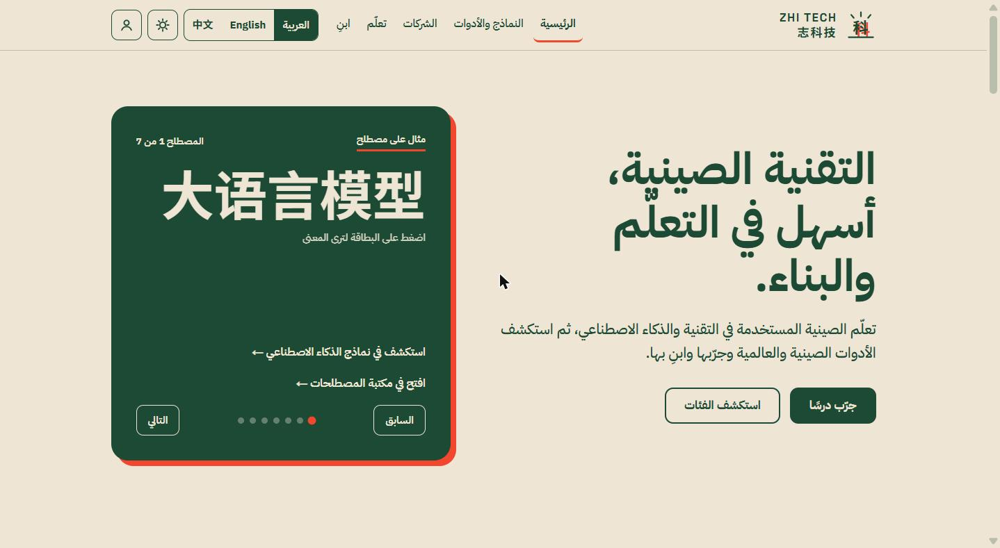
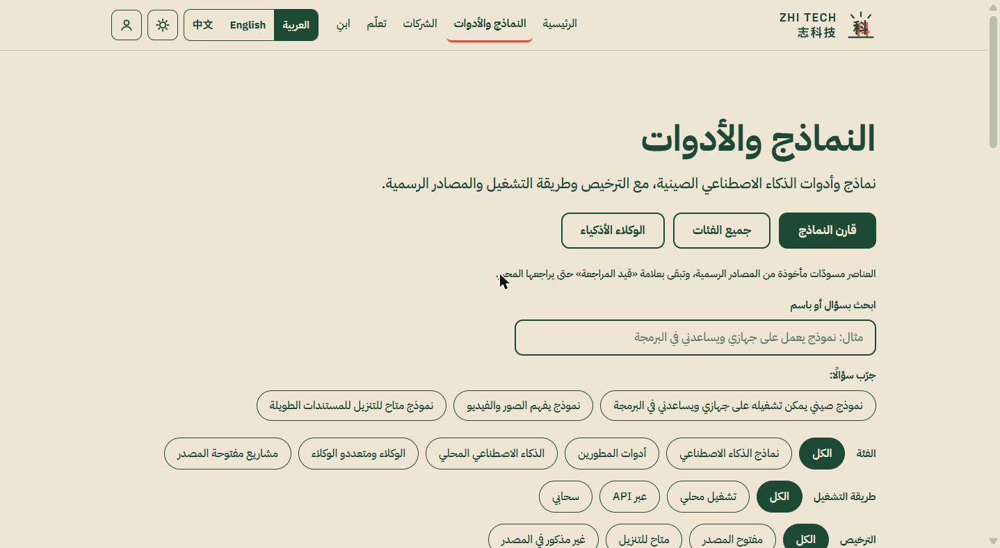
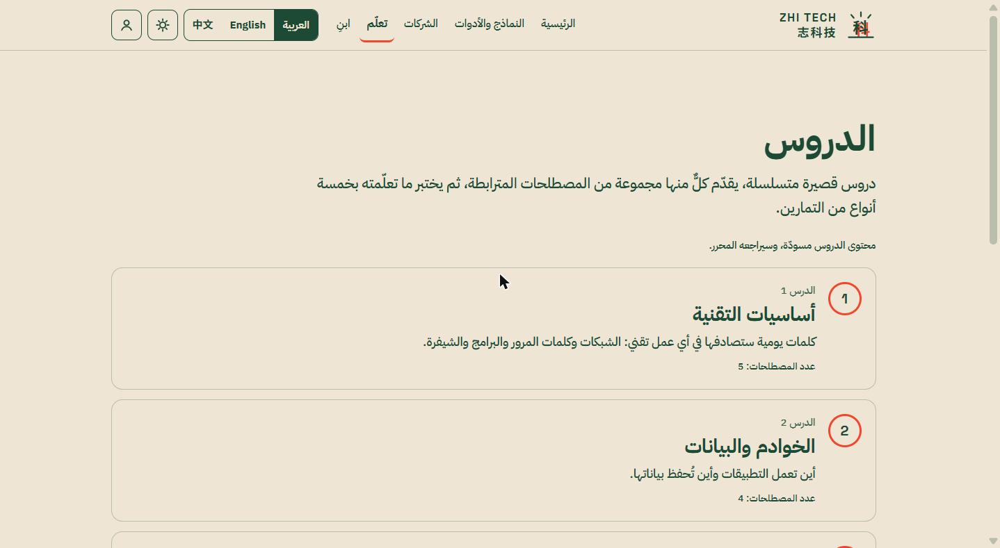
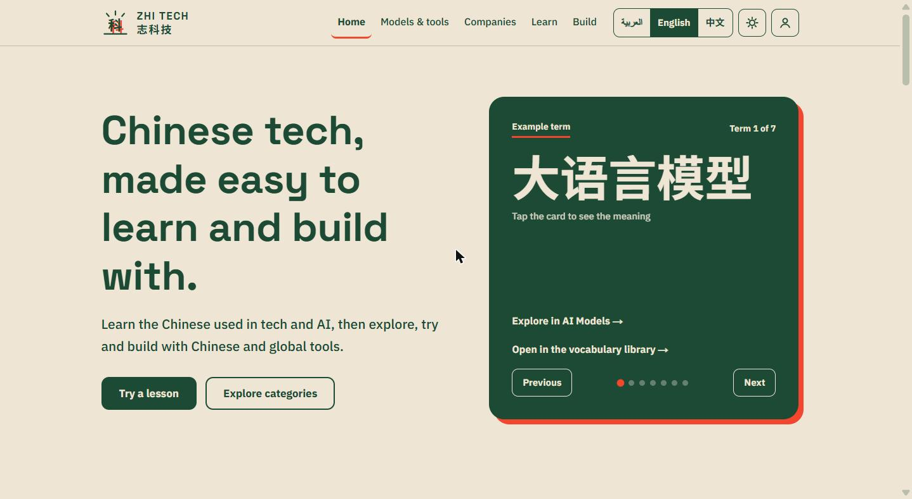
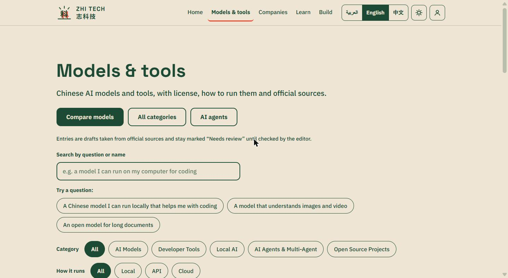
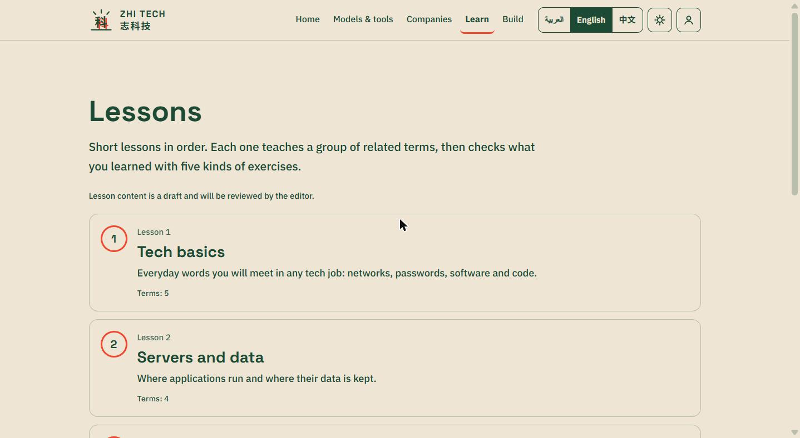
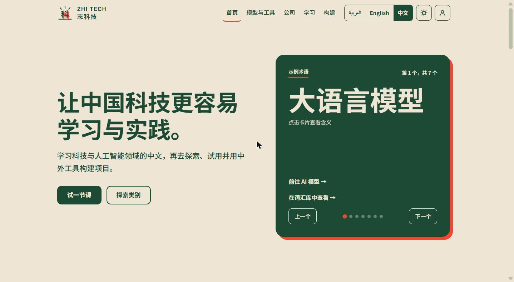
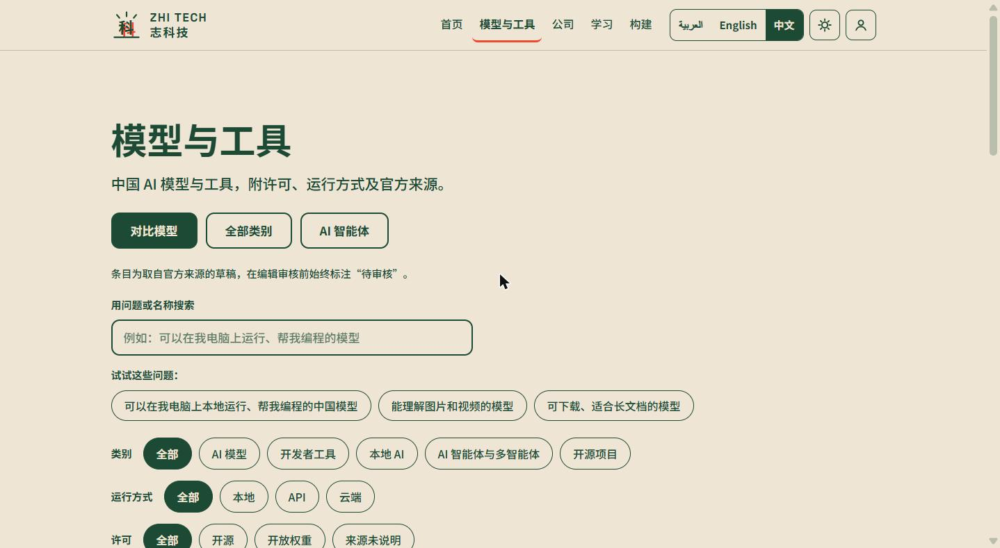
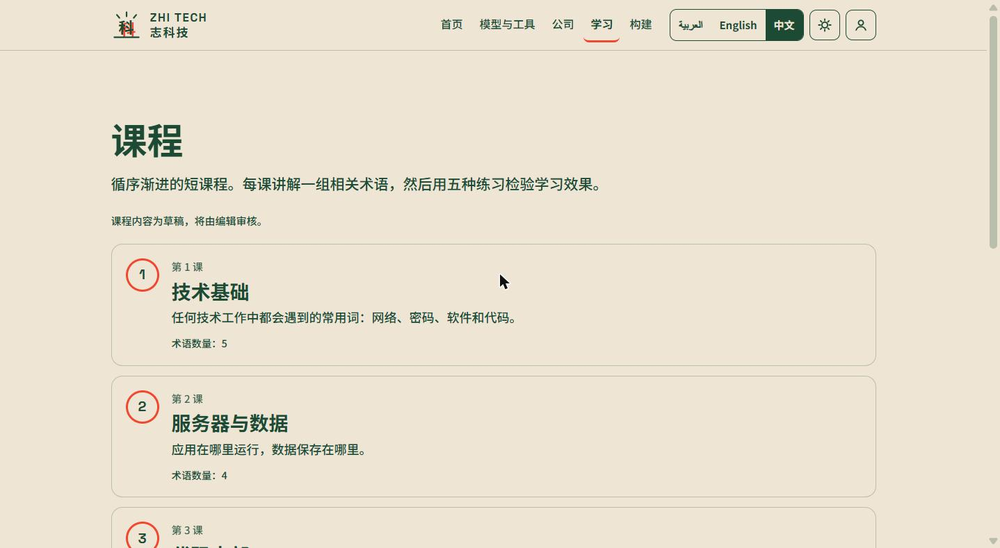

# ZHI TECH · 志科技

[العربية](#العربية) · [English](#english) · [中文](#中文)

---

## العربية

منصة ثلاثية اللغة (عربي · إنجليزي · صيني مبسّط) تجمع بين تعلّم اللغة الصينية واستكشاف عالم الذكاء الاصطناعي الصيني، في مكان واحد.

الفكرة إن الصينية صارت لغة مهمة في عالم التقنية والذكاء الاصطناعي، من النماذج والشركات الكبرى إلى الأدوات اليومية، لكن تعلّمها بسياق تقني وعربي شبه غير موجود. يحاول ZHI TECH سد هذه الفجوة عبر مسارين:

1. **الصينية للتقنية والذكاء الاصطناعي**: مفردات ومفاهيم تقنية بالصينية، مع دروس وتمارين ومراجعة دورية مبنية على أسلوب Leitner لتثبيت الحفظ.
2. **استكشاف وبناء مع الذكاء الاصطناعي الصيني**: دليل للنماذج والأدوات والشركات الصينية في مجال الذكاء الاصطناعي، مع بحث ذكي ومقارنات بين النماذج.

الموقع الحي: [zhi-tech.vercel.app](https://zhi-tech.vercel.app)

### لقطات من الموقع

| الرئيسية | النماذج والأدوات | الدروس |
|---|---|---|
|  |  |  |

### حالة المشروع

مكتمل: استكشاف الأدوات والشركات، بحث ذكي، مقارنات، حسابات ومفضّلة، مكتبة مفردات، دروس تفاعلية، لوحة تعلّم، قاموس شخصي، مراجعة دورية.

قيد التطوير: مساعد محادثة بالذكاء الاصطناعي، ملعب تجريبي، مساحة مشاريع.

هذا مشروع شخصي قيد البناء، والبيانات الظاهرة فيه قيد المراجعة قبل اعتمادها نهائيًا.

---

## English

A trilingual platform (Arabic · English · Simplified Chinese) that brings together learning Chinese and exploring the world of Chinese AI, in one place.

Chinese has become an important language in technology and AI, from major models and companies to everyday tools, yet learning it in a technical, Arabic-friendly context is almost nonexistent. ZHI TECH aims to close that gap through two tracks:

1. **Chinese for Tech & AI**: technical vocabulary and concepts in Chinese, with lessons, exercises, and periodic review built on the Leitner method.
2. **Explore & Build with Chinese AI**: a guide to Chinese AI models, tools, and companies, with smart search and model comparisons.

Live site: [zhi-tech.vercel.app](https://zhi-tech.vercel.app)

### Screenshots

| Home | Models & tools | Lessons |
|---|---|---|
|  |  |  |

### Project status

Completed: tool and company exploration, smart search, comparisons, accounts and favorites, vocabulary library, interactive lessons, learning dashboard, personal dictionary, periodic review.

In progress: AI conversation tutor, playground, projects workspace.

This is a personal project in active development; the data shown is pending review before being finalized.

---

## 中文

志科技（ZHI TECH）是一个三语平台（阿拉伯语・英语・简体中文），将学习中文与探索中国人工智能的世界结合在一起。

中文已成为科技与人工智能领域的重要语言，从主要模型和公司到日常工具，但以技术性、面向阿拉伯语使用者的方式学习中文却几乎是空白。志科技希望通过两条路径填补这一空白：

1. **科技与人工智能中文**：学习科技领域的中文词汇与概念，配合课程、练习，以及基于莱特纳记忆法的周期性复习。
2. **探索与构建中国人工智能**：中国人工智能模型、工具与公司的指南，提供智能搜索与模型对比功能。

在线网站：[zhi-tech.vercel.app](https://zhi-tech.vercel.app)

### 网站截图

| 首页 | 模型与工具 | 课程 |
|---|---|---|
|  |  |  |

### 项目进展

已完成：工具与公司探索、智能搜索、对比功能、账户与收藏、词汇库、互动课程、学习仪表盘、个人词典、周期性复习。

开发中：AI 对话辅导、练习场、项目工作区。

本项目仍在持续开发阶段，所展示的数据在最终确认前仍处于审核状态。
